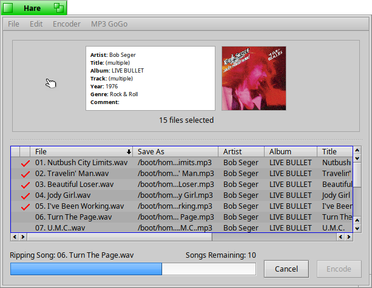

Hare
====

Hare - Haiku Audio Ripper Encoder

Hare is finally in a usable state.  
All of the pending issues that were open on github.com/HaikuArchives/Hare \
have now been fixed.  Give it a try out and if you have any feature requests, \
bugs or crashes to report, open a new issue at github.com/HaikuArchives/Hare
